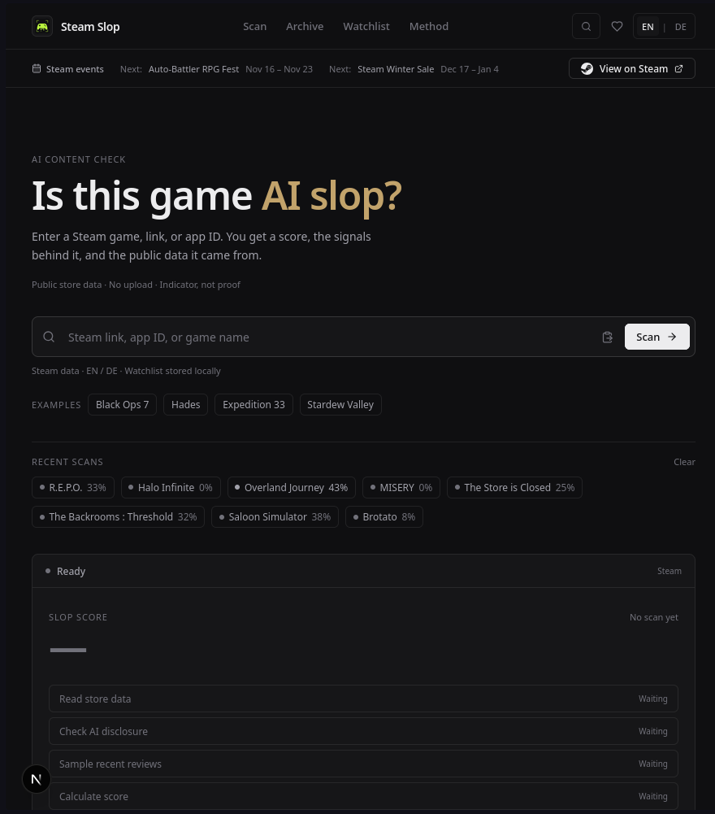
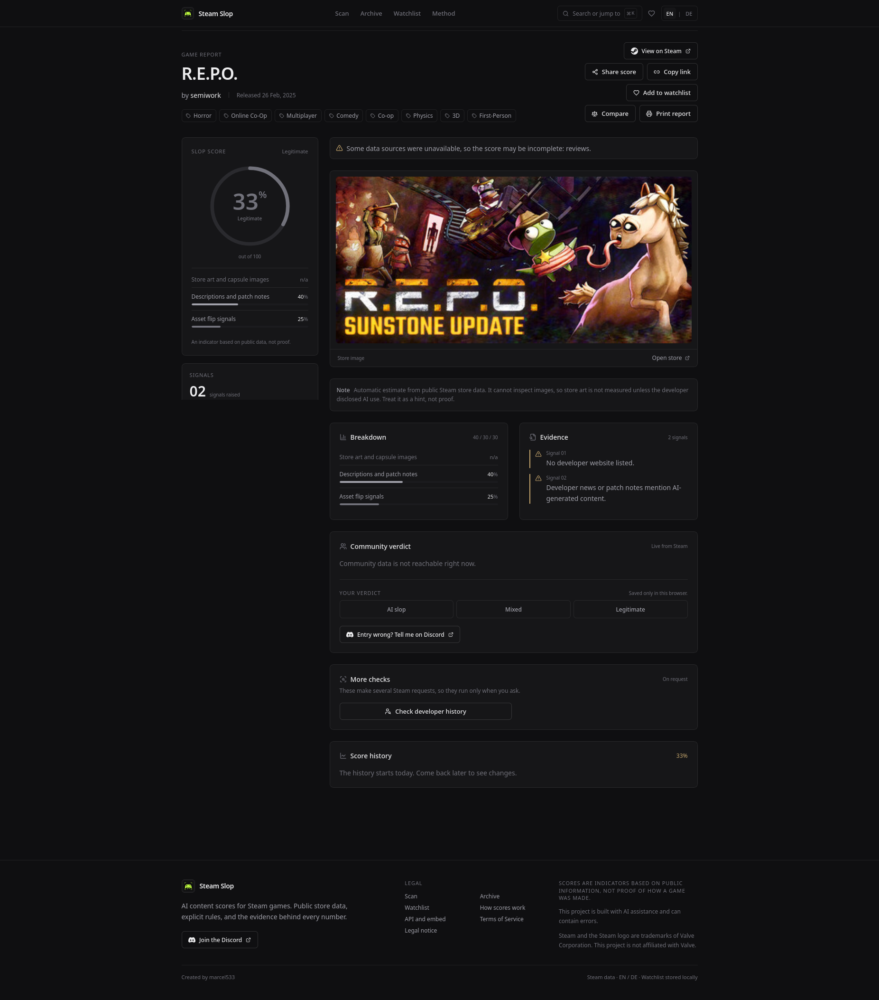
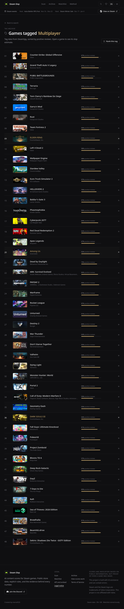
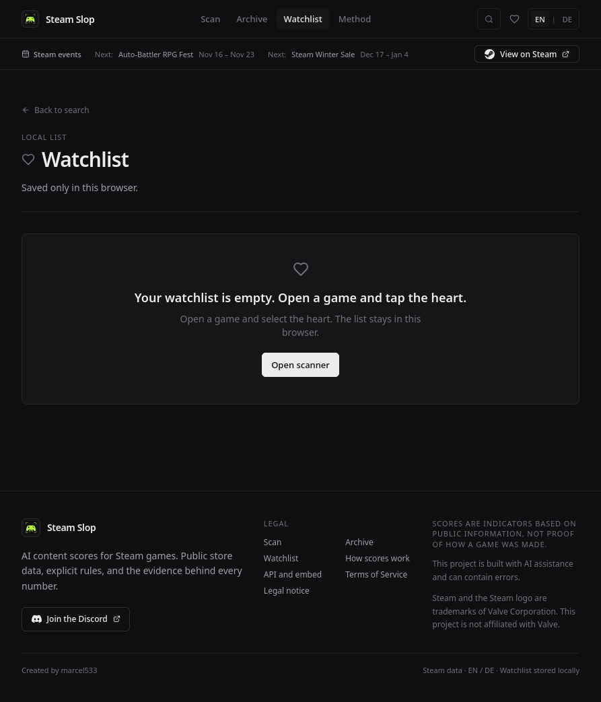

<div align="center">

# 🎮 Steam Slop

**How much of a Steam game is AI-generated? Enter a title, get a slop score.**


[English](#english) · [Deutsch](#deutsch) · [How to run → USE.md](USE.md)

<br>



</div>

---

## English

Steam Slop is a web app that estimates how heavily a Steam game relies on AI-generated assets. You get a **slop score from 0–100%**, a category breakdown, the evidence behind the number, and a link to the store page.

> ⚠️ **The score is a hint, not proof.** It is calculated automatically from public store data and can be wrong in either direction. Never use it to accuse a studio or developer.

### Contents

- [Screenshots](#screenshots)
- [Features](#features)
- [How the score works](#how-the-score-works)
- [Limitations](#limitations)
- [Tech stack](#tech-stack)
- [Getting started](#getting-started)
- [Credits](#credits)

### Screenshots

| Search & curated games | Game detail with slop score |
|:---:|:---:|
|  |  |
| Search any Steam game or browse curated entries and filter them by verdict. | Score, per-category breakdown, evidence, community verdict and a link to Steam. |

| Browse by tag | Watchlist |
|:---:|:---:|
|  |  |
| Tag data from SteamSpy, sorted by positive reviews. Rank the top 12 by slop score with one click. | Games you saved with the heart icon. Stored only in your browser. |

### Features

| Feature | Description |
|---|---|
| **Live search** | Query every game on Steam, with cover art, developer and release date. Fully keyboard-navigable autocomplete. |
| **Slop score** | 0–100%, classified as *AI Slop*, *Mixed*, or *Legitimate*. |
| **Breakdown** | Per-category detail for store/capsule graphics, descriptions & patch notes, and asset-flip signals. |
| **Evidence list** | The specific signals that produced the score. |
| **Community verdict** | Votes, example quotes and tags (curated entries only). You can also set your own verdict, which is saved only in your browser. |
| **Developer history** | On request, checks the developer's other games (runs several Steam requests, so only when you ask). |
| **Score history** | Tracks how a game's score changes over time. |
| **Share, copy link & print** | Share the score, copy a link to the report, or print it. |
| **Tag browsing** | Browse games by Steam tag (data from SteamSpy) and rank the top 12 by slop score. |
| **Watchlist & compare** | Save games to a watchlist and compare them side by side. |
| **Steam events banner** | Shows the current and upcoming Steam sales and fests. |
| **Steam link** | Jump straight to the store page from any game view. |
| **Bilingual UI** | EN \| DE toggle, dark-mode design. |

### How the score works

Entries come from two sources:

1. **Curated entries** (home page): scored from publicly known information, such as AI usage disclosed by the developer.
2. **Every other Steam game**: automatically estimated from public store data.

The overall score is a weighted average of the measurable categories. Categories that read `n/a` are left out and the remaining weights are rescaled.

| Category | Weight | Notes |
|---|:---:|---|
| Store & capsule graphics | 40% | Images are **not** analysed, so this reads `n/a` unless the developer explicitly disclosed AI use. |
| Store text & patch notes | 30% | Looks for LLM-typical phrasing and mentions of AI-generated content. |
| Asset flips | 30% | Indicators of reused or repackaged assets. |

For non-curated games, the estimate draws on:

- LLM-typical phrasing in the store description
- Developer news or patch notes mentioning AI-generated content
- No developer website or support contact
- Very few user reviews
- An unusually low price
- Steam's own "AI Generated Content Disclosure", where present *(best effort, no guarantee)*

<details>
<summary><b>Example: R.E.P.O.</b></summary>

<br>


- Store art: `n/a` (images are not analysed, so this category is left out)
- Descriptions and patch notes: 40%
- Asset flip signals: 25%
- Two signals raised: no developer website listed, and developer news or patch notes mention AI-generated content
- Calculation: (30 × 40 + 30 × 25) / 60 = 32.5, shown as 33%
- Result: **33% – Legitimate**
- The review data source was unreachable, so the page shows a warning that the score may be incomplete

</details>

### Limitations

- The score is an indicator, not proof.
- Store art is not measured unless the developer disclosed AI use.
- If a data source (for example reviews) is unreachable, the score may be incomplete and the page says so.
- Community-contributed data exists only for curated entries; real community reporting would require a dedicated database.

### Tech stack

| Layer | Choice |
|---|---|
| Framework | Next.js 15 (App Router) |
| UI | React 19, Tailwind CSS 3 |
| Icons | Lucide React |
| Animation | GSAP + `@gsap/react` (hero reveal and score counter; disabled under reduced-motion settings) |
| Data | Steam requests proxied through server routes (browser CORS restriction). **No API key required.** |

### Getting started

Full setup instructions are in [USE.md](USE.md). In short:

```bash
npm install
npm run dev
```

Then open <http://localhost:3000>.

⚠️ **File size note:** The distributed file exceeds 100 MB and must be downloaded from [pCloud](https://e.pcloud.link/publink/show?code=XZY41X7ZKtTbdQEL7dbphM60hAJoVkneB2c7).

### Credits

Created by **[marcel533](https://github.com/marcel533)**. Game data and images belong to Valve, Steam, and the respective developers.

**AI note:** this project was generated entirely using AI.

[⬆ Back to top](#-steam-slop)

---

## Deutsch

Steam Slop ist eine Web-App, die abschätzt, wie stark ein Steam-Spiel auf KI-generierte Assets setzt. Du erhältst einen **Slop-Score von 0–100 %**, eine Aufschlüsselung nach Kategorien, die Belege hinter der Zahl und einen Link zur Store-Seite.

> ⚠️ **Der Score ist ein Hinweis, kein Beweis.** Er wird automatisch aus öffentlichen Store-Daten berechnet und kann in beide Richtungen falsch liegen. Verwende ihn niemals, um ein Studio oder einen Entwickler zu beschuldigen.

### Inhalt

- [Screenshots](#screenshots-1)
- [Funktionen](#funktionen)
- [So funktioniert der Score](#so-funktioniert-der-score)
- [Einschränkungen](#einschränkungen)
- [Technologie-Stack](#technologie-stack)
- [Erste Schritte](#erste-schritte)
- [Danksagung](#danksagung)

### Screenshots

| Suche & kuratierte Spiele | Spieldetail mit Slop-Score |
|:---:|:---:|
|  |  |
| Suche jedes Steam-Spiel oder stöbere in kuratierten Einträgen und filtere sie nach Urteil. | Score, Aufschlüsselung pro Kategorie, Belege, Community-Urteil und ein Link zu Steam. |

| Nach Tags stöbern | Merkliste |
|:---:|:---:|
|  |  |
| Tag-Daten von SteamSpy, sortiert nach positiven Bewertungen. Sortiere die Top 12 per Klick nach Slop-Score. | Spiele, die du mit dem Herz-Symbol gespeichert hast. Nur in deinem Browser gespeichert. |

### Funktionen

| Funktion | Beschreibung |
|---|---|
| **Live-Suche** | Durchsuche jedes Spiel auf Steam, mit Cover, Entwickler und Veröffentlichungsdatum. Autovervollständigung, vollständig per Tastatur bedienbar. |
| **Slop-Score** | 0–100 %, eingestuft als *AI Slop*, *Mixed* oder *Legitimate*. |
| **Aufschlüsselung** | Details pro Kategorie für Store-/Capsule-Grafiken, Beschreibungen & Patch-Notes sowie Asset-Flip-Signale. |
| **Belegliste** | Die konkreten Signale, aus denen sich der Score ergibt. |
| **Community-Urteil** | Stimmen, Beispielzitate und Tags (nur kuratierte Einträge). Du kannst auch dein eigenes Urteil setzen, das nur in deinem Browser gespeichert wird. |
| **Entwickler-Historie** | Prüft auf Anfrage die weiteren Spiele des Entwicklers (mehrere Steam-Anfragen, daher nur auf Klick). |
| **Score-Verlauf** | Zeigt, wie sich der Score eines Spiels über die Zeit verändert. |
| **Teilen, Link kopieren & Drucken** | Score teilen, Link zum Bericht kopieren oder den Bericht drucken. |
| **Tag-Browser** | Stöbere nach Steam-Tags (Daten von SteamSpy) und sortiere die Top 12 nach Slop-Score. |
| **Merkliste & Vergleich** | Speichere Spiele in einer Merkliste und vergleiche sie nebeneinander. |
| **Steam-Events-Banner** | Zeigt aktuelle und kommende Steam-Sales und -Festivals. |
| **Steam-Link** | Springe aus jeder Spielansicht direkt zur Store-Seite. |
| **Zweisprachige Oberfläche** | Umschalter EN \| DE, Dark-Mode-Design. |

### So funktioniert der Score

Die Einträge stammen aus zwei Quellen:

1. **Kuratierte Einträge** (Startseite): bewertet anhand öffentlich bekannter Informationen, etwa vom Entwickler offengelegter KI-Nutzung.
2. **Alle anderen Steam-Spiele**: automatisch aus öffentlichen Store-Daten geschätzt.

Der Gesamtscore ist ein gewichteter Durchschnitt der messbaren Kategorien. Kategorien mit `n/a` werden weggelassen und die übrigen Gewichte entsprechend hochgerechnet.

| Kategorie | Gewicht | Hinweise |
|---|:---:|---|
| Store- & Capsule-Grafiken | 40 % | Bilder werden **nicht** analysiert, daher steht hier `n/a`, außer der Entwickler hat KI-Nutzung ausdrücklich offengelegt. |
| Store-Texte & Patch-Notes | 30 % | Sucht nach LLM-typischen Formulierungen und Erwähnungen KI-generierter Inhalte. |
| Asset-Flips | 30 % | Hinweise auf wiederverwendete oder neu verpackte Assets. |

Bei nicht kuratierten Spielen stützt sich die Schätzung auf:

- LLM-typische Formulierungen in der Store-Beschreibung
- Entwickler-News oder Patch-Notes, die KI-generierte Inhalte erwähnen
- Keine Entwickler-Website bzw. kein Support-Kontakt
- Sehr wenige Nutzerbewertungen
- Ein ungewöhnlich niedriger Preis
- Steams eigene „AI Generated Content Disclosure“, sofern vorhanden *(Best Effort, ohne Gewähr)*

<details>
<summary><b>Beispiel: R.E.P.O.</b></summary>

<br>


- Store-Grafiken: `n/a` (Bilder werden nicht analysiert, die Kategorie entfällt)
- Beschreibungen und Patch-Notes: 40 %
- Asset-Flip-Signale: 25 %
- Zwei Signale: keine Entwickler-Website angegeben und Entwickler-News bzw. Patch-Notes erwähnen KI-generierte Inhalte
- Rechnung: (30 × 40 + 30 × 25) / 60 = 32,5, angezeigt als 33 %
- Ergebnis: **33 % – Legitimate**
- Die Review-Datenquelle war nicht erreichbar, daher zeigt die Seite die Warnung, dass der Score unvollständig sein kann

</details>

### Einschränkungen

- Der Score ist ein Indikator, kein Beweis.
- Store-Grafiken werden nicht bewertet, außer der Entwickler hat KI-Nutzung offengelegt.
- Ist eine Datenquelle (z. B. Reviews) nicht erreichbar, kann der Score unvollständig sein; die Seite weist darauf hin.
- Von der Community beigesteuerte Daten gibt es nur für kuratierte Einträge; echte Community-Meldungen würden eine eigene Datenbank erfordern.

### Technologie-Stack

| Schicht | Auswahl |
|---|---|
| Framework | Next.js 15 (App Router) |
| UI | React 19, Tailwind CSS 3 |
| Icons | Lucide React |
| Animation | GSAP + `@gsap/react` (Hero-Einblendung und Score-Zähler; bei aktivierter Einstellung „Bewegung reduzieren“ deaktiviert) |
| Daten | Steam-Anfragen laufen über Server-Routen (wegen der CORS-Einschränkung im Browser). **Kein API-Schlüssel erforderlich.** |

### Erste Schritte

Die vollständige Anleitung steht in [USE.md](USE.md). Kurzfassung:

```bash
npm install
npm run dev
```

Öffne anschließend <http://localhost:3000>.

⚠️ **Hinweis zur Dateigröße:** Die ausgelieferte Datei ist größer als 100 MB und muss von [pCloud](https://e.pcloud.link/publink/show?code=XZY41X7ZKtTbdQEL7dbphM60hAJoVkneB2c7) heruntergeladen werden.

### Danksagung

Erstellt von **[marcel533](https://github.com/marcel533)**. Spieldaten und Bilder gehören Valve, Steam und den jeweiligen Entwicklern.

**KI-Hinweis:** Dieses Projekt wurde vollständig mit KI generiert.

[⬆ Nach oben](#-steam-slop)
