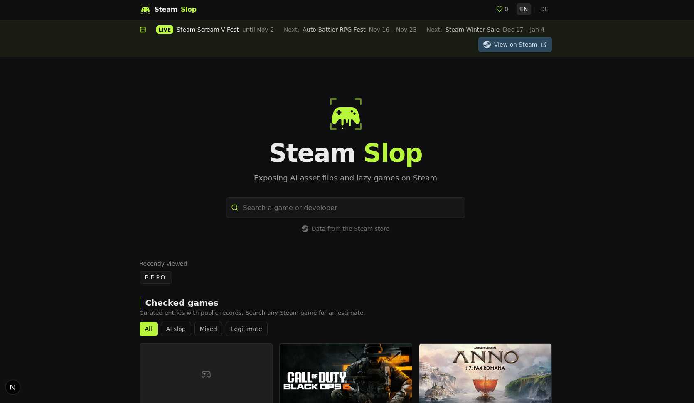
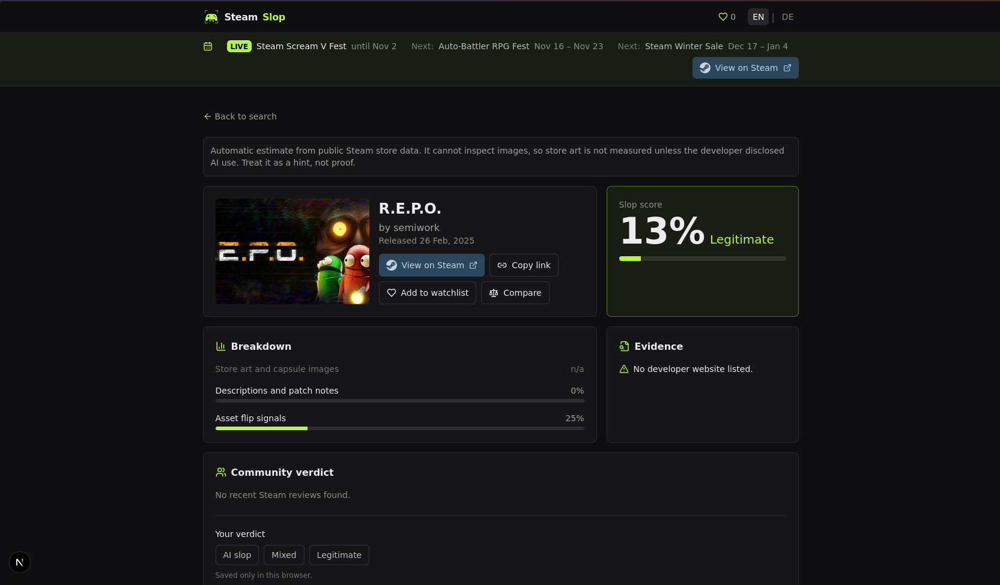
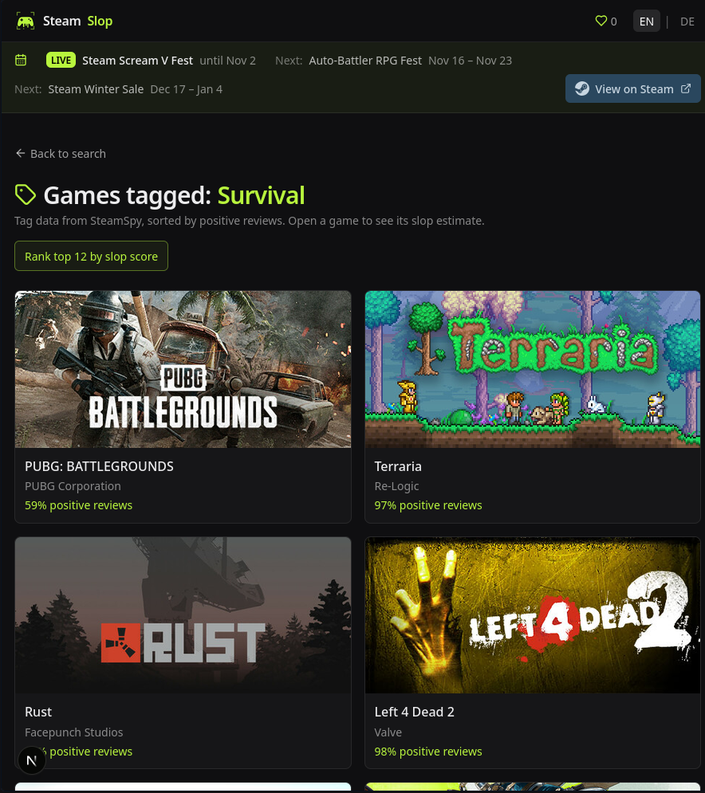
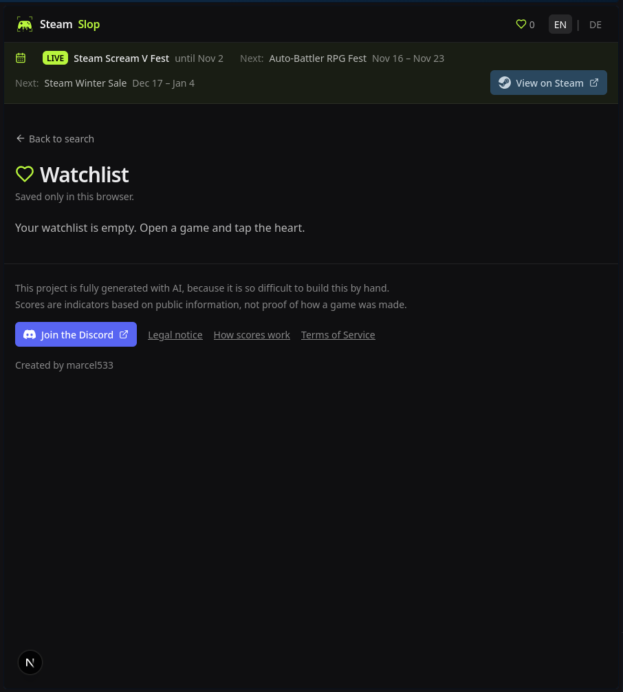

<div align="center">

# 🎮 Steam Slop

**How much of a Steam game is AI-generated? Enter a title, get a slop score.**


[English](#english) · [Deutsch](#deutsch) · [How to run → USE.md](USE.md)

<br>



</div>

---

## English

Steam Slop is a web app that estimates how heavily a Steam game relies on AI-generated assets. You get a **slop score from 0–100%**, a category breakdown, the evidence behind the number, and a link to the store page.

> ⚠️ **The score is a hint, not proof.** It is calculated automatically from public store data and can be wrong in either direction. Never use it to accuse a studio or developer.

### Contents

- [Screenshots](#screenshots)
- [Features](#features)
- [How the score works](#how-the-score-works)
- [Limitations](#limitations)
- [Tech stack](#tech-stack)
- [Getting started](#getting-started)
- [Credits](#credits)

### Screenshots

| Search & curated games | Game detail with slop score |
|:---:|:---:|
|  |  |
| Search any Steam game or browse curated entries and filter them by verdict. | Score, per-category breakdown, evidence, community verdict and a link to Steam. |

| Browse by tag | Watchlist |
|:---:|:---:|
|  |  |
| Tag data from SteamSpy, sorted by positive reviews. Rank the top 12 by slop score with one click. | Games you saved with the heart icon. Stored only in your browser. |

### Features

| Feature | Description |
|---|---|
| **Live search** | Query every game on Steam, with cover art, developer and release date. Fully keyboard-navigable autocomplete. |
| **Slop score** | 0–100%, classified as *AI Slop*, *Mixed*, or *Legitimate*. |
| **Breakdown** | Per-category detail for store/capsule graphics, descriptions & patch notes, and asset-flip signals. |
| **Evidence list** | The specific signals that produced the score. |
| **Community verdict** | Votes, example quotes and tags (curated entries only). You can also set your own verdict, which is saved only in your browser. |
| **Tag browsing** | Browse games by Steam tag (data from SteamSpy) and rank the top 12 by slop score. |
| **Watchlist & compare** | Save games to a watchlist and compare them side by side. |
| **Steam events banner** | Shows the current and upcoming Steam sales and fests. |
| **Steam link** | Jump straight to the store page from any game view. |
| **Bilingual UI** | EN \| DE toggle, dark-mode design. |

### How the score works

Entries come from two sources:

1. **Curated entries** (home page): scored from publicly known information, such as AI usage disclosed by the developer.
2. **Every other Steam game**: automatically estimated from public store data.

The overall score is a weighted average of the measurable categories.

| Category | Weight | Notes |
|---|:---:|---|
| Store & capsule graphics | 40% | Images are **not** analysed, so this reads `n/a` unless the developer explicitly disclosed AI use. |
| Store text & patch notes | 30% | Looks for LLM-typical phrasing. |
| Asset flips | 30% | Indicators of reused or repackaged assets. |

For non-curated games, the estimate draws on:

- LLM-typical phrasing in the store description
- No developer website or support contact
- Very few user reviews
- An unusually low price
- Steam's own "AI Generated Content Disclosure", where present *(best effort, no guarantee)*

<details>
<summary><b>Example: R.E.P.O.</b></summary>

<br>


- Store art: `n/a` (images are not analysed)
- Descriptions and patch notes: 0%
- Asset flip signals: 25%
- No developer website listed, so the evidence section flags it
- Result: **13% – Legitimate**

</details>

### Limitations

- The score is an indicator, not proof.
- Store art is not measured unless the developer disclosed AI use.
- Community-contributed data exists only for curated entries; real community reporting would require a dedicated database.

### Tech stack

| Layer | Choice |
|---|---|
| Framework | Next.js 15 (App Router) |
| UI | React 19, Tailwind CSS 3 |
| Icons | Lucide React |
| Animation | GSAP + `@gsap/react` (hero reveal and score counter; disabled under reduced-motion settings) |
| Data | Steam requests proxied through server routes (browser CORS restriction). **No API key required.** |

### Getting started

Full setup instructions are in [USE.md](USE.md). In short:

```bash
npm install
npm run dev
```

Then open <http://localhost:3000>.

⚠️ **File size note:** The distributed file exceeds 100 MB and must be downloaded from [pcloud](https://e.pcloud.link/publink/show?code=XZY41X7ZKtTbdQEL7dbphM60hAJoVkneB2c7).

### Credits

Created by **[marcel533](https://github.com/marcel533)**. Game data and images belong to Valve, Steam, and the respective developers.

**AI note:** this project was generated entirely using AI.

[⬆ Back to top](#steam-slop)

---

## Deutsch

Steam Slop ist eine Web-App, die einschätzt, wie stark ein Steam-Spiel auf KI-generierte Assets setzt. Du gibst einen Titel ein und erhältst einen **Slop-Wert von 0–100 %** mit Aufschlüsselung, den zugrunde liegenden Belegen und einem Link zur Steam-Seite.

> ⚠️ **Der Wert ist ein Hinweis, kein Beweis.** Er wird automatisch aus öffentlichen Store-Daten berechnet und kann in beide Richtungen falsch liegen. Nicht verwenden, um ein Studio oder einen Entwickler zu beschuldigen.

### Inhalt

- [Screenshots](#screenshots-1)
- [Funktionen](#funktionen)
- [So entsteht der Wert](#so-entsteht-der-wert)
- [Grenzen](#grenzen)
- [Technik](#technik)
- [Erste Schritte](#erste-schritte)
- [Credits](#credits-1)

### Screenshots

| Suche & kuratierte Spiele | Spieleansicht mit Slop-Wert |
|:---:|:---:|
|  |  |
| Beliebiges Steam-Spiel suchen oder kuratierte Einträge nach Urteil filtern. | Wert, Aufschlüsselung, Belege, Community-Urteil und Link zu Steam. |

| Nach Tag stöbern | Merkliste |
|:---:|:---:|
|  |  |
| Tag-Daten von SteamSpy, sortiert nach positiven Reviews. Die Top 12 lassen sich per Klick nach Slop-Wert ranken. | Spiele, die du mit dem Herz gemerkt hast. Nur in deinem Browser gespeichert. |

### Funktionen

| Funktion | Beschreibung |
|---|---|
| **Live-Suche** | Durchsucht alle Steam-Spiele inklusive Cover, Entwickler und Erscheinungsdatum, mit per Tastatur bedienbarer Autovervollständigung. |
| **Slop-Wert** | 0 bis 100 % mit Urteil: *KI-Slop*, *Gemischt* oder *Legitim*. |
| **Aufschlüsselung** | Getrennt nach Store-Grafiken und Kapselbildern, Beschreibungen und Patchnotes sowie Asset-Flip-Hinweisen. |
| **Belege** | Die konkreten Hinweise, die zum Wert geführt haben. |
| **Community-Urteil** | Stimmen, Beispielzitat und Tags (nur bei kuratierten Einträgen). Du kannst auch ein eigenes Urteil setzen, das nur in deinem Browser gespeichert wird. |
| **Tag-Suche** | Spiele nach Steam-Tag durchstöbern (Daten von SteamSpy) und die Top 12 nach Slop-Wert ranken. |
| **Merkliste & Vergleich** | Spiele merken und nebeneinander vergleichen. |
| **Steam-Events-Leiste** | Zeigt aktuelle und kommende Steam-Sales und -Fests. |
| **Steam-Link** | Direkt zur Store-Seite aus jeder Spielansicht. |
| **Zweisprachig** | EN \| DE Umschalter, dunkles Design. |

### So entsteht der Wert

Es gibt zwei Arten von Einträgen:

1. **Kuratierte Einträge** (Startseite): Werte auf Basis öffentlich bekannter Angaben, etwa von Entwicklern offengelegter KI-Nutzung.
2. **Alle anderen Steam-Spiele**: automatische Schätzung aus öffentlichen Store-Daten.

Der Gesamtwert ist ein gewichteter Durchschnitt der messbaren Kategorien.

| Kategorie | Gewicht | Hinweis |
|---|:---:|---|
| Store-Grafiken & Kapselbilder | 40 % | Bilder werden **nicht** analysiert, daher steht hier `n/a`, außer der Entwickler hat KI-Nutzung ausdrücklich angegeben. |
| Beschreibung & Patchnotes | 30 % | Sucht nach typischen LLM-Floskeln. |
| Asset-Flip | 30 % | Hinweise auf wiederverwendete oder neu verpackte Assets. |

Bei nicht kuratierten Spielen fließen ein:

- typische LLM-Floskeln in der Store-Beschreibung
- keine Entwickler-Website oder kein Support-Kontakt
- sehr wenige Nutzerreviews
- ein sehr niedriger Preis
- Steams „AI Generated Content Disclosure“, sofern vorhanden *(ohne Garantie)*

<details>
<summary><b>Beispiel: R.E.P.O.</b></summary>

<br>


- Store-Grafiken: `n/a` (Bilder werden nicht analysiert)
- Beschreibungen und Patchnotes: 0 %
- Asset-Flip-Signale: 25 %
- Keine Entwickler-Website angegeben, das wird in den Belegen markiert
- Ergebnis: **13 % – Legitim**

</details>

### Grenzen

- Der Wert ist ein Indikator, kein Beweis.
- Store-Grafiken werden nicht gemessen, außer der Entwickler hat KI-Nutzung offengelegt.
- Community-Daten gibt es nur für kuratierte Einträge; echte Community-Meldungen bräuchten eine Datenbank.

### Technik

| Ebene | Wahl |
|---|---|
| Framework | Next.js 15 (App Router) |
| UI | React 19, Tailwind CSS 3 |
| Icons | Lucide React |
| Animation | GSAP mit `@gsap/react` (Hero-Einblendung und Hochzählen des Werts; bei reduzierter Bewegung abgeschaltet) |
| Daten | Steam-Anfragen laufen über Server-Routen, weil Browser Steam nicht direkt abfragen dürfen (CORS). **Kein API-Key nötig.** |

### Erste Schritte

Die vollständige Anleitung steht in [USE.md](USE.md). Kurzfassung:

```bash
npm install
npm run dev
```

Danach <http://localhost:3000> öffnen.

⚠️ **Dateigröße:** Die Datei überschreitet 100 MB und muss über [pcloud](https://e.pcloud.link/publink/show?code=XZY41X7ZKtTbdQEL7dbphM60hAJoVkneB2c7) heruntergeladen werden.

### Credits

Erstellt von **[marcel533](https://github.com/marcel533)**. Spieldaten und Bilder gehören Valve, Steam und den jeweiligen Entwicklern.

**KI-Hinweis:** Dieses Projekt ist vollständig mit KI generiert.

[⬆ Nach oben](#steam-slop)
